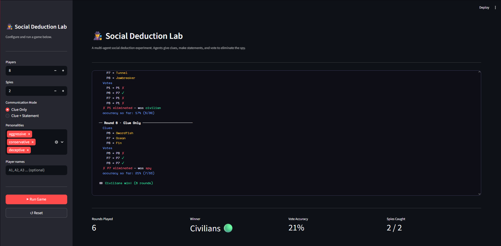

# 🕵️ Multi-Agent Deception Simulation

> What happens when intelligent agents try to deceive each other… and nothing behaves as expected?

This project explores deception in multi-agent systems through a simulation inspired by the game *Spyfall*. It combines **LLM-based agents**, **behavioral personalities**, and **communication constraints** to study how deception emerges in complex, stochastic environments.

---

## 📄 Research Paper

📌 *From Communication to Behavior: An Empirical Study of Deception in Multi-Agent Systems*  
🔗 https://doi.org/10.17605/OSF.IO/X9N2Q

---

## 🚀 Project Overview

This project was built to investigate a simple but intuitive question:

> Does increasing communication improve deception in multi-agent systems?

To explore this, a simulation environment was developed where agents interact under uncertainty, attempt to deceive, and identify hidden adversaries.

---

## 🎥 Demo

Here’s a look at the interactive **Social Deduction Lab** built using Streamlit:



This interface allows you to run a **full multi-agent game simulation in real time**, closely mirroring the experimental setup used in the research.

### 🧪 What you can do

- 🎮 Configure the game:
  - Number of players and spies  
  - Communication mode (*Clue Only* or *Clue + Statement*)  
  - Personality distribution (Aggressive, Conservative, Deceptive)  

- ▶️ Run a complete game simulation with a single click  

- 📜 Observe detailed, step-by-step logs:
  - Clue generation  
  - Statements (if enabled)  
  - Voting behavior  
  - Player eliminations  

- 📊 Track final outcomes:
  - Winner (Spies vs Civilians)  
  - Number of rounds  
  - Voting accuracy  
  - Spies identified  

---

### 💡 Why this demo matters

This isn’t just a visualization — it lets you **experience the system behavior directly**.

> Even with similar configurations, outcomes can vary —  
> highlighting the **stochastic and interaction-driven nature** of the system.

---

### 🚀 Run it locally

```bash
pip install streamlit
streamlit run app.py
```
---

## 🧠 Key Components

- 🤖 **LLM-Based Agents**  
  Agents simulate human-like reasoning and communication.

- 🎭 **Personality Types**  
  - Aggressive  
  - Conservative  
  - Deceptive  

- 💬 **Communication Modes**  
  - Clue Only  
  - Clue + Statement  

- 🔁 **Repeated Simulations**  
  Multiple runs to observe patterns and variability.

---

## 🔍 Key Findings

- ❌ Increasing communication does not significantly improve deception  
- ❌ No personality consistently outperforms others  
- ⚠️ Results vary across runs due to randomness  

> 💡 Deception emerges from interaction dynamics rather than individual strategy.

---

## 🧪 Features

- Multi-agent simulation system  
- Personality-driven agent behavior  
- Communication-based experimentation  
- Streamlit-powered interactive interface  

---

## ⚠️ Limitations
High randomness in simulation setup

Imbalanced personality distribution

Limited control over experimental variables

Results may vary across runs

---

## 🔮 Future Work
Introduce controlled experimental conditions

Balance personality and role assignments

Improve reproducibility

Expand agent strategies and behaviors

---

## 👤 Author
Harshit

---

## 💭 Final Note
This project is not about perfect results.

It’s about understanding how complex systems behave when expectations fail — and what that reveals about interaction, uncertainty, and emergent behavior.